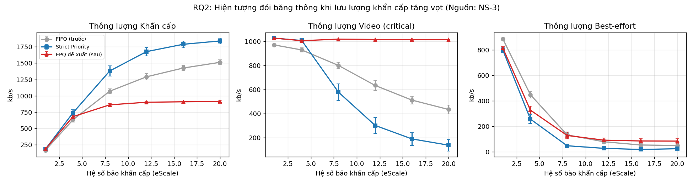

# Cơ chế QoS ưu tiên dữ liệu khẩn cấp trên NS-3

Dự án đề xuất và đánh giá bằng mô phỏng **EPQ (Emergency-aware Priority Queue)**, một queue disc mới cho NS-3. EPQ giúp dữ liệu khẩn cấp có trễ thấp và không mất gói khi mạng nghẽn, đồng thời không làm "chết đói" băng thông của các lớp lưu lượng khác khi lưu lượng khẩn cấp tăng đột biến.

## Kết quả chính (ns-3.42, 195 lần chạy, 5 lần lặp × 60 s)

| Chỉ số | FIFO | Strict Priority | **EPQ** |
|---|---|---|---|
| Trễ TB khẩn cấp, ρ = 1,2 | 343,91 ms | 20,69 ms | **20,69 ms** |
| Mất gói khẩn cấp, ρ = 1,2 | 31,04% | 0% | **0%** |
| Mất gói video, ρ = 1,2 | 18,96% | 0% | **0%** |
| Thông lượng video khi bão khẩn cấp (eScale = 20) | 433 kb/s | 136 kb/s | **1015 kb/s** |

Kết quả tái lập hoàn toàn khi chạy lại trên một máy thứ hai.




## Thuật toán EPQ

1. **Phân loại DSCP**: EF/CS6 → khẩn cấp; AF4x/CS4/CS5 → critical (video); còn lại → best-effort.
2. **Push-out theo thứ bậc**: bộ đệm chung 100 gói; khi đầy, gói lớp cao đẩy bỏ gói đầu hàng của lớp thấp hơn.
3. **Giai đoạn 1 – ưu tiên tuyệt đối có hạn mức**: token bucket (R_E = 600 kb/s, B = 15000 byte).
4. **Giai đoạn 2 – DRR**: phần vượt hạn mức được hạ cấp, chia sẻ với các lớp khác theo quantum 1500 : 4500 : 1500 byte.

Bảo đảm lý thuyết: video luôn có tối thiểu (C − R_E)·4500/7500 = 840 kb/s; trễ hàng đợi khẩn cấp ≤ (L_max + B)·8/C = 66 ms khi lưu lượng khẩn cấp tuân thủ hạn mức.

## Cấu trúc thư mục

```
├── ns3/scratch/emergency-qos/   mã nguồn NS-3 (chép vào ~/ns-3-dev/scratch/)
│   ├── emergency-qos.cc         kịch bản: topology, lưu lượng, FlowMonitor, xuất CSV
│   ├── qos-components.h/.cc     DscpPacketFilter + EmergencyQueueDisc (EPQ)
├── scripts/
│   ├── run_experiments.sh       chạy 3 thí nghiệm (195 cấu hình) và vẽ biểu đồ
│   ├── plot_results.py          thống kê (CI 95%), 6 biểu đồ, summary.md
│   └── sim_reference.py         mô hình tham chiếu Python (kiểm chứng logic)
├── results/                     ns3_results.csv, reference_results.csv
├── figures/ns3/                 biểu đồ từ NS-3 + summary.md
├── figures/reference/           biểu đồ từ mô hình tham chiếu
└── docs/                        báo cáo (.docx) và slide thuyết trình (.pptx)
```

## Cách chạy

Yêu cầu: Ubuntu 22.04, ns-3.40 trở lên (đã kiểm tra trên ns-3.42), g++ ≥ 10, cmake ≥ 3.13, Python 3 + matplotlib.

```bash
# 1. Cài đặt và build NS-3 (chỉ các module cần thiết)
sudo apt install -y g++ cmake ninja-build python3 python3-matplotlib git wget bzip2
wget https://www.nsnam.org/releases/ns-allinone-3.42.tar.bz2
tar xjf ns-allinone-3.42.tar.bz2 && mv ns-allinone-3.42/ns-3.42 ~/ns-3-dev
cd ~/ns-3-dev
./ns3 configure --build-profile=optimized \
  --enable-modules="core;network;internet;point-to-point;applications;traffic-control;flow-monitor"
./ns3 build -j2

# 2. Chạy thử một cấu hình
cp -r <thư-mục-repo>/ns3/scratch/emergency-qos ~/ns-3-dev/scratch/
./ns3 build -j2
./ns3 run "emergency-qos --scheme=fifo --load=1.2 --simTime=20"
./ns3 run "emergency-qos --scheme=epq  --load=1.2 --simTime=20"

# 3. Chạy toàn bộ thí nghiệm (1–3 giờ) và vẽ biểu đồ
cd <thư-mục-repo>
NS3_DIR=~/ns-3-dev RUNS=5 SIM_TIME=60 ./scripts/run_experiments.sh

# Chỉ vẽ lại biểu đồ từ CSV có sẵn
python3 scripts/plot_results.py results/ns3_results.csv --outdir figures/ns3 --label "NS-3"
```

Tham số dòng lệnh chính của `emergency-qos`: `--scheme=fifo|prio|epq`, `--load`, `--eScale`, `--eRate`, `--eBurst`, `--pushOut`, `--simTime`, `--run`, `--out`.

## Thí nghiệm

| Thí nghiệm | Biến thay đổi | Câu hỏi |
|---|---|---|
| A – quét tải | ρ = 0,6 … 1,6 | RQ1: hiệu quả khi nghẽn |
| B – bão khẩn cấp | eScale = 1 … 20 | RQ2: chống chết đói |
| C – độ nhạy | R_E = 300 / 600 / 1000 kb/s | RQ3: đánh đổi tham số |

## Hạn chế

Khi lưu lượng khẩn cấp vượt xa hạn mức, EPQ mất nhiều gói khẩn cấp hơn Strict Priority (75,3% so với 50,2% tại eScale = 20) và trễ p95 của video tăng lên khoảng 588 ms. Mô phỏng hiện chỉ dùng mạng có dây với một nút cổ chai.
